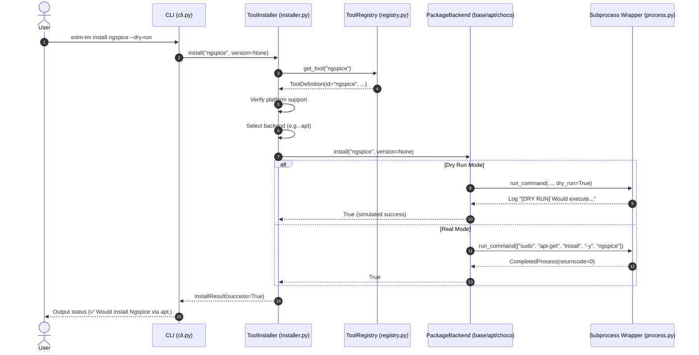
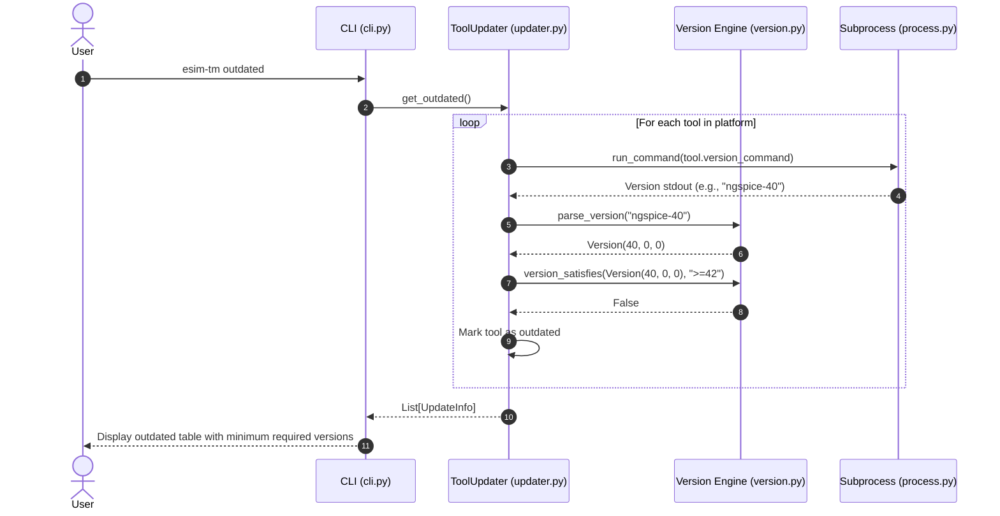
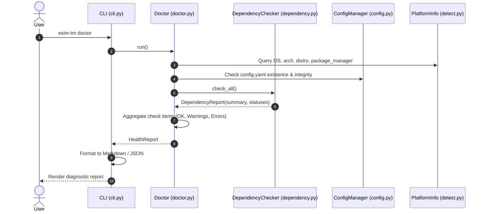

# Technical Design Document: eSim Automated Tool Manager

**Author:** Mukul Sharma (`sharma23Mukul`)  
**Target:** FOSSEE eSim Winter Internship 2026 (IIT Bombay), Task 5  
**Package:** `esim_toolmanager` (`esim-tm`)  
**Status:** Complete / Prototype Implemented  
**Date:** November 2026  

---

## 1. Goals and Non-Goals

### 1.1 Goals
- **Automated Lifecycle**: Simplify installation, verification, configuration, and upgrades of external EDA tools required by eSim (Ngspice, KiCad, GHDL, Verilator, LLVM, etc.).
- **Cross-Platform Compatibility**: Provide a uniform interface across Linux (Debian/Ubuntu/APT), macOS (Homebrew), and Windows (Chocolatey/winget).
- **Declarative & Extensible (Manifest-Driven)**: Maintain tool definitions, version commands, compatibility ranges, and package mappings in an external YAML manifest (`tools.yaml`). New tools must be addable without editing Python source code.
- **Safety by Default**: Guarantee safe dry-run execution (`--dry-run`) across all mutating commands. Never perform irreversible destructive changes without automated backup (`.bak`).
- **Comprehensive Diagnostics**: Supply an automated `doctor` command producing diagnostic Markdown and JSON reports for bug reporting and support triage.
- **Minimal Dependencies**: Build upon Python 3.8+ standard library, requiring only `PyYAML` as an external dependency.

### 1.2 Non-Goals
- **Replacing System Package Managers**: The tool manager acts as an intelligent orchestrator on top of existing package managers (`apt`, `brew`, `choco`), rather than compiling every tool from raw source or implementing a custom package format.
- **Managing eSim Core Itself**: The manager manages external dependencies and tools used by eSim; it does not replace eSim's GUI or simulation orchestration scripts.
- **System-Wide Package Purging**: The tool does not perform system-wide uninstalls that could break other OS applications unless explicitly directed in isolated environments.

---

## 2. Architecture Overview

`esim_toolmanager` is designed as a modular, 4-tier layered architecture:

```mermaid
graph TD
    subgraph UI_Layer ["1. Presentation Layer"]
        CLI["CLI Interface (esim_toolmanager.cli)<br/>argparse, colorized output, JSON emitter"]
    end

    subgraph Core_Layer ["2. Core Domain Layer"]
        Registry["Tool Registry (core.registry)<br/>Manifest parser & query engine"]
        Installer["Tool Installer (core.installer)<br/>Installation orchestrator"]
        Updater["Tool Updater (core.updater)<br/>Outdated analyzer & upgrader"]
        Config["Config Manager (core.config)<br/>Env vars, PATH, shell scripts, backup"]
        DepCheck["Dependency Checker (core.dependency)<br/>Topological sort, cycle detection"]
        Doctor["Health Doctor (core.doctor)<br/>System & dependency diagnostic reporter"]
    end

    subgraph Backend_Layer ["3. Backend Abstraction Layer"]
        BaseBackend["PackageBackend (backends.base)<br/>Abstract base interface"]
        APT["AptBackend (backends.apt)<br/>apt-get / dpkg wrapper"]
        Brew["BrewBackend (backends.brew)<br/>Homebrew formula manager"]
        Choco["ChocoBackend (backends.choco)<br/>Chocolatey package manager"]
        Pip["PipBackend (backends.pip_backend)<br/>Python pip backend"]
    end

    subgraph Support_Layer ["4. Infrastructure & Platform Layer"]
        Platform["Platform Detector (platform.detect)<br/>OS, arch, distro, PM discovery"]
        Version["Version Engine (utils.version)<br/>PEP-440 semantic version parser"]
        Process["Process Runner (utils.process)<br/>Subprocess isolation & dry-run runner"]
        Log["Logging Engine (utils.log)<br/>Rotating file handler & ANSI console"]
        Manifest["tools.yaml<br/>Declarative single source of truth"]
    end

    CLI --> Installer
    CLI --> Updater
    CLI --> Config
    CLI --> DepCheck
    CLI --> Doctor
    CLI --> Registry

    Installer --> Registry
    Installer --> BaseBackend
    Updater --> Registry
    Updater --> BaseBackend
    DepCheck --> Registry
    Doctor --> DepCheck
    Doctor --> Config
    Doctor --> Registry
    Config --> Registry

    BaseBackend <|-- APT
    BaseBackend <|-- Brew
    BaseBackend <|-- Choco
    BaseBackend <|-- Pip

    Registry --> Manifest
    BaseBackend --> Process
    Platform --> BaseBackend
    Core_Layer --> Platform
    Core_Layer --> Version
    Core_Layer --> Log
```

---

## 3. Module Breakdown

### 3.1 Presentation Layer
- **`esim_toolmanager.cli`**:
  - **Purpose**: Unified entry point for the command line application (`esim-tm`).
  - **Responsibilities**: Command parsing via `argparse`, options dispatch (`list`, `check`, `install`, `update`, `outdated`, `configure`, `doctor`, `logs`), exit code translation, formatted output (table / JSON).
  - **Dependencies**: `core.*`, `platform.detect`, `utils.log`, `utils.version`.

### 3.2 Core Domain Layer
- **`esim_toolmanager.core.registry`**:
  - **Classes**: `ToolDefinition`, `ToolRegistry`.
  - **Purpose**: Parses `tools.yaml`, builds typed `ToolDefinition` dataclasses, enables queries filtered by category, platform, or requirement status, and merges external custom manifests.
  - **Dependencies**: `PyYAML`, `dataclasses`.
- **`esim_toolmanager.core.installer`**:
  - **Classes**: `ToolInstaller`, `InstallResult`.
  - **Purpose**: Resolves the optimal package manager backend based on host platform and manifest mapping, verifies platform compatibility, applies version pinning, and executes installation.
  - **Dependencies**: `core.registry`, `backends.*`, `platform.detect`.
- **`esim_toolmanager.core.updater`**:
  - **Classes**: `ToolUpdater`, `UpdateInfo`, `UpdateResult`.
  - **Purpose**: Compares installed runtime tool versions against minimum version constraints defined in `tools.yaml`, identifies outdated tools, and drives updates via the active backend.
  - **Dependencies**: `core.registry`, `backends.*`, `utils.version`, `utils.process`.
- **`esim_toolmanager.core.config`**:
  - **Classes**: `ConfigManager`.
  - **Purpose**: Manages `~/.esim-toolmanager/config.yaml`, registers required paths and environment variables (`SPICE_LIB_DIR`, `LLVM_DIR`, `PATH`), creates timestamped backups before updates, and generates shell integration scripts (`bash`, `zsh`, `fish`, `powershell`, `cmd`).
  - **Dependencies**: `PyYAML`, `shutil`, `datetime`.
- **`esim_toolmanager.core.dependency`**:
  - **Classes**: `DependencyChecker`, `ToolStatus`, `DependencyReport`.
  - **Purpose**: Recursively validates tool presence and version compatibility. Implements cycle-guarded depth-first search for topological installation ordering. Produces actionable fix suggestions.
  - **Dependencies**: `core.registry`, `utils.process`, `utils.version`.
- **`esim_toolmanager.core.doctor`**:
  - **Classes**: `Doctor`, `HealthReport`, `CheckItem`.
  - **Purpose**: Collects system environment telemetry (OS, architecture, distro, active package manager, Python version), verifies config integrity, checks tool statuses, and renders reports into GitHub Flavored Markdown or structured JSON.
  - **Dependencies**: `core.registry`, `core.dependency`, `core.config`, `platform.detect`.

### 3.3 Backend Abstraction Layer
- **`esim_toolmanager.backends.base`**:
  - **Classes**: `PackageBackend` (Abstract Base Class).
  - **Interface**: `is_available()`, `is_installed(pkg)`, `get_installed_version(pkg)`, `install(pkg, version)`, `update(pkg)`, `update_index()`. All mutating actions strictly respect `self.dry_run`.
- **`esim_toolmanager.backends.apt`**: APT package manager integration (`apt-get`, `dpkg`, `dpkg-query`).
- **`esim_toolmanager.backends.brew`**: macOS Homebrew formula integration (`brew list`, `brew install`, `brew upgrade`).
- **`esim_toolmanager.backends.choco`**: Windows Chocolatey integration (`choco list`, `choco install`, `choco upgrade`).
- **`esim_toolmanager.backends.pip_backend`**: Cross-platform Python package installer (`python -m pip`).

### 3.4 Infrastructure & Support Layer
- **`esim_toolmanager.platform.detect`**: Analyzes `platform.system()`, `platform.machine()`, `/etc/os-release`, and executable discovery (`shutil.which`) to produce immutable `PlatformInfo`.
- **`esim_toolmanager.utils.version`**: Parses semver patterns and evaluates comparison constraints (`>=`, `<=`, `==`, `!=`, `>`, `<`, `~=`).
- **`esim_toolmanager.utils.process`**: Provides safe subprocess execution (`subprocess.run`), regex output matching, and dry-run interception.
- **`esim_toolmanager.utils.log`**: Configures multi-level ANSI colorized terminal logging and thread-safe rotating file logging (`1MB`, 5 backups).

---

## 4. Component Data Flows

### 4.1 Tool Installation Flow (`install`)



### 4.2 Update and Outdated Check Flow (`outdated` / `update`)



### 4.3 Health Check Diagnostic Flow (`doctor`)



---

## 5. Tool Manifest Schema (`tools.yaml`)

The manifest file is the declarative single source of truth:

```yaml
schema_version: "1.0"           # Schema compatibility version

esim_versions:                   # Constraints per eSim release
  "2.5":
    description: "eSim 2.5 release"
    tool_constraints:
      ngspice: ">=42"
      kicad: ">=7.0"
      python3: ">=3.8"

tools:
  <tool_id>:                     # Unique alphanumeric identifier
    name: "Tool Display Name"    # Human-readable name
    description: "Description"   # Short description of EDA role
    homepage: "https://..."      # Official project URL
    category: "simulation"       # simulation | design | compiler | runtime | other
    required: true               # true if mandatory for eSim execution
    version_command:             # Command to execute for version inspection
      - "tool-binary"
      - "--version"
    version_pattern: "(\\d+\\.\\d+)"  # Regex with capture group for semver
    min_version: "1.0"           # Minimum compatible version (optional)
    max_version: null            # Maximum compatible version (optional)
    pinned_version: null         # Exact pinned version if required (optional)
    packages:                    # Package name per backend
      apt: "tool-pkg"
      brew: "tool-formula"
      choco: "tool-pkg"
      pip: null
    dependencies:                # IDs of upstream tool dependencies
      - "python3"
    config_hints:                # Environment settings required by tool
      env_vars:
        TOOL_HOME: "/usr/share/tool"
      paths:
        - "/usr/share/tool/bin"
    platforms:                   # Supported OS list: linux, darwin, windows
      - linux
      - darwin
      - windows
```

---

## 6. Design Decisions & Trade-Offs

| Decision | Alternative Considered | Rationale & Trade-off |
|---|---|---|
| **YAML for Manifest** | JSON / INI / TOML | **Chosen:** YAML provides clean multi-line string support and comments for documentation. Non-developers can easily add tools. Requires `PyYAML` dependency (justified in `requirements.txt`). |
| **`argparse` Standard Library** | `click` / `typer` | **Chosen:** Zero external dependencies for CLI routing. `argparse` is battle-tested, fast, and part of standard Python 3.8+. |
| **Abstract Backend Pattern** | Direct shell commands / Ansible | **Chosen:** Decouples tool business logic from OS-specific installation semantics. Makes adding new package managers (e.g. `dnf`, `pacman`, `winget`) straightforward. |
| **First-Class `--dry-run`** | Read-only simulation flag | **Chosen:** Essential for safety and grading evaluation. Guarantees testing and validation without mutating host system state. |
| **Automated Config Backup** | In-place overwrite | **Chosen:** Creates timestamped `.bak` files before any configuration mutation, preventing corrupted environment settings. |
| **Custom Version Parser** | `packaging` / `distutils` | **Chosen:** Standardizes version comparison without relying on `distutils` (deprecated in Python 3.12) or requiring `packaging` as a runtime dependency. |

---

## 7. Security Considerations

1. **No Remote Code Execution (RCE)**: The manager never executes unverified curl-to-bash scripts or downloads random unverified shell scripts. All installations are delegated to system-level package managers (`apt`, `brew`, `choco`).
2. **List-Form Subprocess Execution**: All shell commands are executed as discrete argument lists (`["apt-get", "install", "-y", pkg]`) rather than string interpolation with `shell=True`, eliminating shell injection risks.
3. **Elevated Privileges Boundary**: The CLI runs as an unprivileged user process. Where administrative rights are required (e.g., `apt-get`), `sudo` is explicitly passed within the list command and guarded by `--dry-run`.
4. **Credential Isolation**: No user passwords or tokens are stored in configuration or log files.
5. **Path Normalization**: Paths added to configuration scripts are validated and deduplicated to prevent `PATH` poisoning.

---

## 8. Testing Strategy

The test suite is structured under `tests/` with **100% mocked execution**:
- **Mocking Strategy**: `unittest.mock.patch` intercepts all `subprocess.run`, `shutil.which`, and filesystem writes. No test ever invokes real external installers.
- **Dedicated Test Manifest**: Tests run against `tests/fixtures/test_tools.yaml` to guarantee test isolation from production manifest modifications.
- **Coverage Target**: 80% minimum enforced in `pyproject.toml` (`--cov-report=term-missing --cov-fail-under=80`). Current achieved coverage: **85.75%** across 159 unit tests.
- **Continuous Integration**: GitHub Actions workflow (`.github/workflows/ci.yml`) executes the test suite across Ubuntu and Windows runners.

---

## 9. Requirement Traceability Matrix

| Official Requirement | Primary Module | Demonstrating Command | Test Coverage |
|---|---|---|---|
| **1. Tool Installation Management** | `esim_toolmanager.core.installer`<br/>`esim_toolmanager.backends.*` | `esim-tm install <tool>`<br/>`esim-tm install --all` | `tests/test_installer.py`<br/>`tests/test_backends.py`<br/>`tests/test_cli.py::TestCmdInstall` |
| **2. Update & Upgrade System** | `esim_toolmanager.core.updater`<br/>`esim_toolmanager.utils.version` | `esim-tm outdated`<br/>`esim-tm update [tool]` | `tests/test_version.py`<br/>`tests/test_updater.py`<br/>`tests/test_cli.py::TestCmdOutdated` |
| **3. Configuration Handling** | `esim_toolmanager.core.config` | `esim-tm configure`<br/>`esim-tm configure --export` | `tests/test_config.py`<br/>`tests/test_cli.py::TestCmdConfigure` |
| **4. Dependency Checker** | `esim_toolmanager.core.dependency` | `esim-tm check`<br/>`esim-tm list` | `tests/test_dependency.py`<br/>`tests/test_cli.py::TestCmdCheck` |
| **5. User Interface & Logs** | `esim_toolmanager.cli`<br/>`esim_toolmanager.utils.log` | `esim-tm --help`<br/>`esim-tm logs` | `tests/test_cli.py`<br/>`tests/test_log.py` |
| **Optional: Cross-Platform** | `esim_toolmanager.platform.detect`<br/>`esim_toolmanager.backends.*` | `esim-tm list`<br/>`esim-tm doctor` | `tests/test_platform.py`<br/>`tests/test_backends.py` |
| **Creativity: Health Doctor** | `esim_toolmanager.core.doctor` | `esim-tm doctor`<br/>`esim-tm doctor --format json` | `tests/test_doctor.py`<br/>`tests/test_cli.py::TestCmdDoctor` |
| **Creativity: Safe Dry-Run** | `esim_toolmanager.utils.process` | Universal `--dry-run` flag | `tests/test_installer.py`<br/>`tests/test_config.py` |
