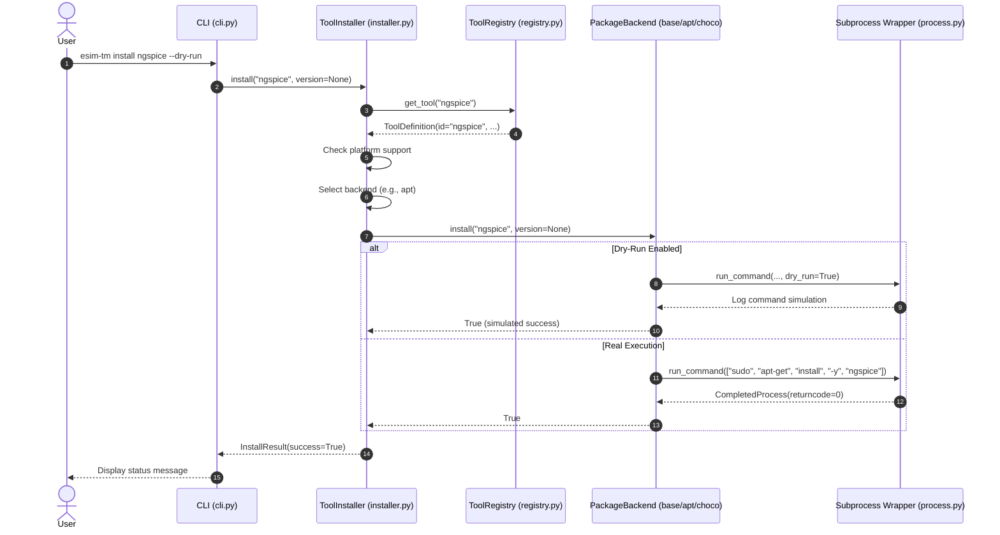
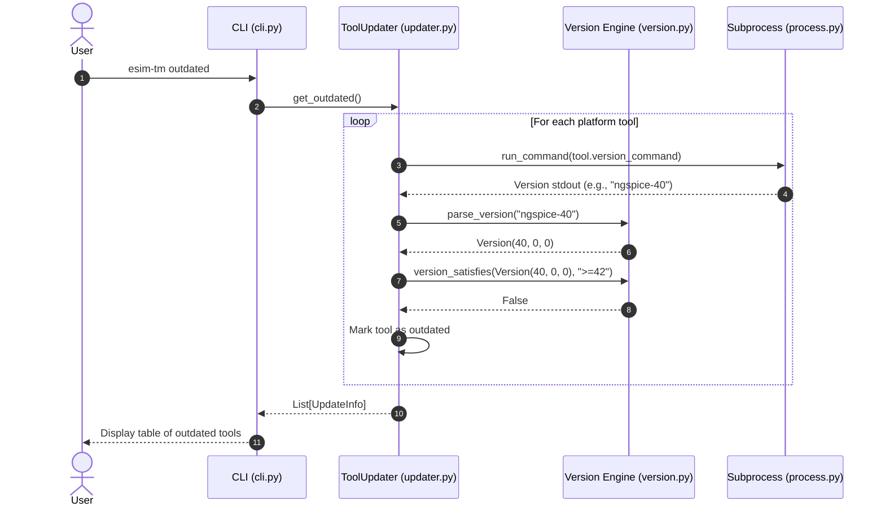
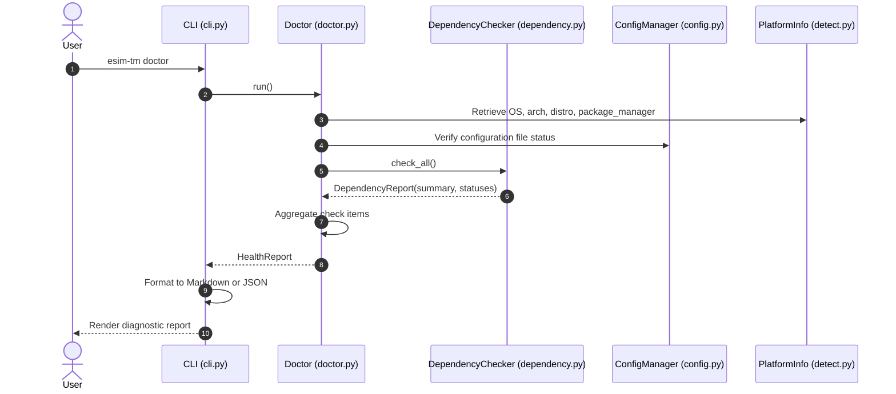

# Technical Design Document: eSim Automated Tool Manager

**Author:** Mukul Sharma (`sharma23Mukul`)  
**Project:** eSim Automated Tool Manager (`esim_toolmanager` / `esim-tm`)  
**Target:** eSim EDA Ecosystem (FOSSEE, IIT Bombay)  
**Status:** Implemented & Verified  

---

## 1. Goals and Non-Goals

### 1.1 Goals
- **Automate Toolchain Lifecycle**: Handle installation, dependency verification, path configuration, and version updates for tools needed by eSim (Ngspice, KiCad, GHDL, Verilator, LLVM, Python libraries).
- **Cross-Platform Compatibility**: Provide uniform functionality across Linux (Debian/Ubuntu via APT), macOS (via Homebrew), and Windows (via Chocolatey).
- **Declarative Manifest Architecture**: Decouple tool specifications, detection rules, and package manager mappings from execution logic using a YAML manifest (`tools.yaml`).
- **Safe Execution by Default**: Ensure all mutating actions support non-destructive simulation (`--dry-run`). Prevent configuration loss by creating timestamped backups (`.bak`) before saving modifications.
- **Automated Health Diagnostics**: Include a `doctor` command that runs sanity checks on package managers, paths, and tool versions, exporting reports in Markdown and JSON.
- **Minimal External Dependencies**: Rely almost exclusively on the Python standard library, requiring only `PyYAML` for manifest parsing.

### 1.2 Non-Goals
- **Replacing Host Package Managers**: The tool manager wraps existing system package managers (`apt`, `brew`, `choco`) rather than implementing a custom binary distribution format.
- **Modifying eSim Core Source Code**: The manager configures external binary dependencies and environment variables; it does not alter eSim's Python application code.
- **Unchecked System Package Removal**: To prevent breaking system dependencies, package removal is left to system administrators.

---

## 2. Architecture Overview

`esim_toolmanager` is built using a layered architecture that isolates presentation, business logic, package backends, and platform utilities:

```mermaid
graph TD
    subgraph UI_Layer ["1. Presentation Layer"]
        CLI["CLI Interface (cli.py)<br/>Argument parsing, table formatter, JSON output"]
    end

    subgraph Core_Layer ["2. Core Domain Layer"]
        Registry["Tool Registry (core/registry.py)<br/>Manifest loader and query interface"]
        Installer["Tool Installer (core/installer.py)<br/>Installation orchestration & version pinning"]
        Updater["Tool Updater (core/updater.py)<br/>Version comparison & update execution"]
        Config["Config Manager (core/config.py)<br/>Environment variable, PATH, and backup management"]
        DepCheck["Dependency Checker (core/dependency.py)<br/>Dependency graph resolution & cycle detection"]
        Doctor["Health Doctor (core/doctor.py)<br/>System & dependency diagnostic reporting"]
    end

    subgraph Backend_Layer ["3. Backend Abstraction Layer"]
        BaseBackend["PackageBackend (backends/base.py)<br/>Abstract base interface"]
        APT["AptBackend (backends/apt.py)<br/>apt-get / dpkg wrapper"]
        Brew["BrewBackend (backends/brew.py)<br/>Homebrew formula manager"]
        Choco["ChocoBackend (backends/choco.py)<br/>Chocolatey package manager"]
        Pip["PipBackend (backends/pip_backend.py)<br/>Python pip backend"]
    end

    subgraph Support_Layer ["4. Infrastructure & Platform Layer"]
        Platform["Platform Detector (platform/detect.py)<br/>OS, architecture, and package manager discovery"]
        Version["Version Engine (utils/version.py)<br/>PEP-440 version parser & comparator"]
        Process["Process Runner (utils/process.py)<br/>Subprocess isolation & dry-run runner"]
        Log["Logging Engine (utils/log.py)<br/>Rotating file handler & console logger"]
        Manifest["tools.yaml<br/>Declarative tool specifications"]
    end

    CLI --> Installer
    CLI --> Updater
    CLI --> Config
    CLI --> DepCheck
    CLI --> Doctor
    CLI --> Registry

    Installer --> Registry
    Installer --> BaseBackend
    Updater --> Registry
    Updater --> BaseBackend
    DepCheck --> Registry
    Doctor --> DepCheck
    Doctor --> Config
    Doctor --> Registry
    Config --> Registry

    BaseBackend <|-- APT
    BaseBackend <|-- Brew
    BaseBackend <|-- Choco
    BaseBackend <|-- Pip

    Registry --> Manifest
    BaseBackend --> Process
    Platform --> BaseBackend
    Core_Layer --> Platform
    Core_Layer --> Version
    Core_Layer --> Log
```

---

## 3. Module Breakdown

### 3.1 Presentation Layer
- **`esim_toolmanager.cli`**:
  - Handles command dispatch (`list`, `check`, `install`, `update`, `outdated`, `configure`, `doctor`, `logs`).
  - Implements output formatting for human-readable terminal tables and machine-readable JSON (`--json`).
  - Standardizes CLI exit codes across all commands.

### 3.2 Core Domain Layer
- **`esim_toolmanager.core.registry`**:
  - Loads and validates the YAML manifest (`tools.yaml`).
  - Exposes query methods filtered by category, platform, or requirement status.
  - Allows merging custom user manifests via `--manifest`.
- **`esim_toolmanager.core.installer`**:
  - Selects the target package manager backend based on host platform and manifest definitions.
  - Verifies platform support before attempting installation.
  - Supports installing specific versions or pinned release tags.
- **`esim_toolmanager.core.updater`**:
  - Compares currently installed versions against minimum constraints in `tools.yaml`.
  - Determines which tools require updates and invokes the corresponding backend.
- **`esim_toolmanager.core.config`**:
  - Stores configuration state in `~/.esim-toolmanager/config.yaml`.
  - Tracks tool environment variables (`SPICE_LIB_DIR`, `LLVM_DIR`) and search paths.
  - Automatically creates timestamped `.bak` files before saving changes.
  - Generates shell integration scripts for Bash, Zsh, Fish, PowerShell, and Cmd.
- **`esim_toolmanager.core.dependency`**:
  - Traverses tool dependency trees recursively.
  - Detects cyclic dependencies using graph traversal safeguards.
  - Provides suggested remediation steps when dependencies are missing or outdated.
- **`esim_toolmanager.core.doctor`**:
  - Collects environment details (OS, architecture, active package manager, Python version).
  - Validates configuration file integrity and runs dependency diagnostics.
  - Formats results into Markdown or JSON reports.

### 3.3 Backend Abstraction Layer
- **`esim_toolmanager.backends.base.PackageBackend`**:
  - Abstract base interface defining: `is_available()`, `is_installed(pkg)`, `get_installed_version(pkg)`, `install(pkg, version)`, `update(pkg)`, and `update_index()`.
  - Guarantees that when `self.dry_run` is enabled, no modifying subprocesses are spawned.
- **Implementations**:
  - `AptBackend`: Interacts with `apt-get` and `dpkg-query`.
  - `BrewBackend`: Interacts with Homebrew (`brew list`, `brew install`, `brew upgrade`).
  - `ChocoBackend`: Interacts with Chocolatey (`choco list`, `choco install`, `choco upgrade`).
  - `PipBackend`: Interacts with Python's pip via `sys.executable -m pip`.

### 3.4 Infrastructure & Support Layer
- **`esim_toolmanager.platform.detect`**: Identifies OS family, distribution version (via `/etc/os-release`), architecture, and available package manager binaries.
- **`esim_toolmanager.utils.version`**: Parses semantic version strings and evaluates version constraints (`>=`, `<=`, `==`, `!=`, `<`, `>`, `~=`).
- **`esim_toolmanager.utils.process`**: Runs subprocesses using list-based argument passing (`subprocess.run`), handles timeout limits, and prints simulation logs in dry-run mode.
- **`esim_toolmanager.utils.log`**: Manages terminal logging and a rotating log file (`1MB`, up to 5 backups).

---

## 4. Sequence Diagrams

### 4.1 Tool Installation (`install`)



### 4.2 Outdated Detection and Update (`outdated` / `update`)



### 4.3 Health Diagnostics (`doctor`)



---

## 5. Tool Manifest Schema (`tools.yaml`)

```yaml
schema_version: "1.0"

esim_versions:
  "2.5":
    description: "eSim 2.5 release"
    tool_constraints:
      ngspice: ">=42"
      kicad: ">=7.0"
      python3: ">=3.8"

tools:
  <tool_id>:
    name: "Display Name"
    description: "Tool role in eSim"
    homepage: "https://project.org"
    category: "simulation"       # simulation | design | compiler | runtime | other
    required: true               # true if mandatory for eSim core workflows
    version_command:
      - "binary-name"
      - "--version"
    version_pattern: "(\\d+\\.\\d+)"
    min_version: "1.0"
    max_version: null
    pinned_version: null
    packages:
      apt: "package-name"
      brew: "formula-name"
      choco: "package-name"
      pip: null
    dependencies:
      - "parent_tool_id"
    config_hints:
      env_vars:
        VAR_NAME: "/path/to/dir"
      paths:
        - "/path/to/bin"
    platforms:
      - linux
      - darwin
      - windows
```

---

## 6. Design Decisions & Trade-Offs

| Decision | Alternative | Rationale |
|---|---|---|
| **YAML for Tool Manifest** | JSON / INI | YAML supports inline comments and readable multi-line values, making it practical for maintainers to add tools without code changes. |
| **Standard Library `argparse`** | `click` / `typer` | Keeps the tool lightweight and avoids extra dependencies on production systems. |
| **Abstract Backend Pattern** | Inline shell commands | Separates tool definitions from OS-specific command syntax, allowing clean addition of new backends (such as `pacman` or `dnf`). |
| **First-Class `--dry-run`** | Ad-hoc verbose mode | Guarantees non-destructive validation and enables testing without altering system configuration. |
| **Automated Config Backups** | Direct overwrite | Creates timestamped `.bak` files automatically before writing configuration updates, preventing accidental loss of settings. |

---

## 7. Security Considerations

1. **Injection Prevention**: Commands are passed to `subprocess.run` as argument lists without `shell=True`, preventing shell injection vulnerabilities.
2. **Restricted Privileges**: The tool manager runs in user space. Root permissions (`sudo`) are requested only when required by system package managers (`apt`), and can always be previewed first with `--dry-run`.
3. **No Unverified Script Downloads**: Installations rely on recognized package managers (`apt`, `brew`, `choco`, `pip`) rather than downloading untrusted shell scripts from arbitrary URLs.
4. **Environment Isolation**: Export scripts generated by `configure` are written to standard output or a designated config file, requiring explicit user evaluation (`eval`).

---

## 8. Testing Strategy

The test suite is located in `tests/` and structured as follows:
- **Process Isolation**: All calls to `subprocess.run` and `shutil.which` are mocked. No tests install packages or alter system settings.
- **Isolated Fixtures**: Tests run against a dedicated test manifest (`tests/fixtures/test_tools.yaml`).
- **Coverage**: Pytest enforces a minimum 80% coverage threshold. The test suite contains 169 unit and integration tests achieving **88% coverage**.

---

## 9. Requirements Traceability

| Requirement | Module | CLI Demonstration | Unit Tests |
|---|---|---|---|
| **Tool Installation** | `core/installer.py`<br/>`backends/` | `esim-tm install <tool>`<br/>`esim-tm install --all` | `tests/test_installer.py`<br/>`tests/test_backends.py` |
| **Update System** | `core/updater.py`<br/>`utils/version.py` | `esim-tm outdated`<br/>`esim-tm update [tool]` | `tests/test_updater.py`<br/>`tests/test_version.py` |
| **Configuration Handling** | `core/config.py` | `esim-tm configure`<br/>`esim-tm configure --export` | `tests/test_config.py` |
| **Dependency Checking** | `core/dependency.py` | `esim-tm check`<br/>`esim-tm list` | `tests/test_dependency.py` |
| **User Interface & Logging** | `cli.py`<br/>`utils/log.py` | `esim-tm --help`<br/>`esim-tm logs` | `tests/test_cli.py` |
| **Cross-Platform Support** | `platform/detect.py`<br/>`backends/` | Linux, macOS, and Windows backend resolution | `tests/test_platform.py`<br/>`tests/test_backends.py` |
| **Health Diagnostics** | `core/doctor.py` | `esim-tm doctor` | `tests/test_doctor.py` |
| **Dry-Run Mode** | `utils/process.py`<br/>`backends/base.py` | Universal `--dry-run` flag | `tests/test_installer.py`<br/>`tests/test_updater.py` |
